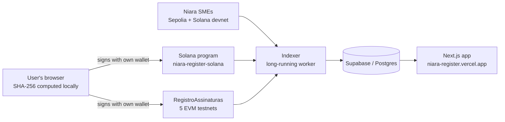

# Niara Register

**The record and trust layer of Niara: on-chain proof of existence and authorship for documents, plus a public ledger of real on-chain transactions across six networks.**

- **Live app:** [niara-register.vercel.app](https://niara-register.vercel.app)
- **Product demo (3 min):** [youtube.com/watch?v=ZNhbzGMrvZo](https://www.youtube.com/watch?v=ZNhbzGMrvZo)
- **Try it:** [niara-register.vercel.app/signatures](https://niara-register.vercel.app/signatures). Pick a network, drop a file and sign with your own wallet.

> **Status: testnet and devnet only.** Records are real transactions on public test networks. The contracts have tests but **no external audit**. A Niara Register record is a complementary piece of evidence. It does **not** replace a notary (cartório) or ICP-Brasil, and it has no automatic legal effect.

---

## What it does

Niara is a financial infrastructure that connects documents, companies, assets and markets: **Register → SMEs → Exchange → Neobank**. Register is the first layer. Every other Niara product writes its records here.

The app has three areas:

| Area | Route | What it shows |
|---|---|---|
| **Document signing** | [`/signatures`](https://niara-register.vercel.app/signatures) | The user selects a file and the browser computes its **SHA-256 hash locally**, so the file is never uploaded. The user connects a **self-custody wallet**, checks whether that hash is already on-chain, and signs a transaction that records the hash, the signer, a timestamp, and the document's name and type. Below the form is a ledger of every recorded document, from all six networks. |
| **SME Registry** | [`/sme-registry`](https://niara-register.vercel.app/sme-registry) | A mirror of the real investment transactions of [Niara SMEs](https://niara-pmes.vercel.app) (offerings created, investments, closings, share redemptions, fund releases, refunds) on **Ethereum Sepolia** and **Solana devnet**. Each entry links to its transaction on the block explorer. |
| **Global Registry** | [`/global-registry`](https://niara-register.vercel.app/global-registry) | Reserved for Niara Exchange. It is **intentionally empty** until the Exchange runs real transactions, because simulated data is never shown as real. |

There is also an `/explorer` route that reads transactions and addresses live from the official RPC. It exists for **HyperEVM Testnet**, which has no working public block explorer, and it shows the `curl` calls so anyone can repeat the query.

The site is bilingual (English by default, Portuguese available).

## Networks and contracts

The same document can be recorded and verified on six networks. The EVM contract was deployed from the same wallet at nonce 0, so it has **the same address on every EVM network**.

| Network | Contract / program | Explorer |
|---|---|---|
| **Solana devnet** | `9RPHqLouFjoUbPdcmA1GyHMeDoWvjZMuCyYFPBWLmTcR` | [Solana Explorer](https://explorer.solana.com/address/9RPHqLouFjoUbPdcmA1GyHMeDoWvjZMuCyYFPBWLmTcR?cluster=devnet) |
| Ethereum Sepolia | `0x5627857ee73f37d6da96530ed08c07339dd9d93a` | [Etherscan](https://sepolia.etherscan.io/address/0x5627857ee73f37d6da96530ed08c07339dd9d93a) |
| Base Sepolia | `0x5627857ee73f37d6da96530ed08c07339dd9d93a` | [BaseScan](https://sepolia.basescan.org/address/0x5627857ee73f37d6da96530ed08c07339dd9d93a) |
| Robinhood Chain Testnet | `0x5627857ee73f37d6da96530ed08c07339dd9d93a` | [Robinhood Explorer](https://explorer.testnet.chain.robinhood.com/address/0x5627857ee73f37d6da96530ed08c07339dd9d93a) |
| HyperEVM Testnet | `0x5627857ee73f37d6da96530ed08c07339dd9d93a` | [Niara RPC reader](https://niara-register.vercel.app/explorer/hyperevm-testnet/address/0x5627857ee73f37d6da96530ed08c07339dd9d93a) |
| Tempo Testnet | `0x5627857ee73f37d6da96530ed08c07339dd9d93a` | [Tempo Explorer](https://explore.testnet.tempo.xyz/address/0x5627857ee73f37d6da96530ed08c07339dd9d93a) |

Wallets: **Phantom or Solflare** on Solana, and **MetaMask or a compatible wallet** on the EVM networks.

The SME Registry also reads the Niara SMEs contracts: the Sepolia offering orchestrator `0xde9cc84d1300b57f640f2d1862900393b82796e5`, and the Solana devnet program `FKefGFhUmgXBM1xCtSFBWpoNnp3wuPJs6Yddpsp67J2y` ([niara-pmes-solana](https://github.com/niaragaed/niara-pmes-solana)).

**On Solana**, each record is a PDA derived from the document hash (`["assinatura", hash]`). Recording the same hash twice fails, so nobody can overwrite or back-date a document. See [niara-register-solana](https://github.com/niaragaed/niara-register-solana).

## Architecture



- **`app/`, `components/`, `lib/`**: the Next.js 16 app (React 19, Tailwind v4, TypeScript). It reads the ledger from Supabase and talks to wallets directly (ethers v6 on EVM, `@solana/web3.js` on Solana).
- **`indexer/`**: a long-running Node/TypeScript worker, hosted on Railway. It reads events from every network and writes them to Postgres. It is idempotent per `(tx_hash, log_index)` or `(network, hash)`, so it can restart without duplicating or losing rows. Each source has its own checkpoint and loop, so a slow RPC on one network never delays the others. On Solana, an event is accepted only when it was emitted inside our own program's invoke frame, so another program cannot forge a ledger entry. The indexer is a mirror, not a source of truth: the chain is the source of truth. More detail in [`indexer/README.md`](indexer/README.md) (in Portuguese).
- **`supabase/`**: the canonical schema (`schema.sql`) and numbered migrations (`migrations_002` to `migrations_010`).

## Built during the Colosseum hackathon

The site and the Sepolia indexer were started in September 2026. During the hackathon I added:

- The **Solana program** for document registration ([niara-register-solana](https://github.com/niaragaed/niara-register-solana)) and Phantom/Solflare signing and verification in the app.
- The **multichain signature ledger**: the same contract on Base Sepolia, Robinhood Chain Testnet, HyperEVM Testnet and Tempo Testnet, all indexed side by side with Sepolia and Solana.
- The **RPC-based explorer** for HyperEVM Testnet.
- The **Solana version of the Niara SMEs ledger**, indexing the [niara-pmes-solana](https://github.com/niaragaed/niara-pmes-solana) program (offering created, investment, closing, redemption, release, refund).

## Running locally

Web app: create `.env.local` with `NEXT_PUBLIC_SUPABASE_URL`, `NEXT_PUBLIC_SUPABASE_ANON_KEY` and, optionally, `NEXT_PUBLIC_SOLANA_RPC_URL`. Then:

```bash
npm install
npm run dev                        # http://localhost:3000
```

Indexer: create `indexer/.env` with `ALCHEMY_API_KEY`, `SUPABASE_URL` and `SUPABASE_SERVICE_ROLE_KEY`. Every RPC URL and network setting has a default (see [`indexer/config.ts`](indexer/config.ts)). Then:

```bash
cd indexer
npm install
npm start                          # or: npx tsx index.ts --dry-run (reads everything, writes nothing)
npm run teste                      # offline tests + one cycle against Solana devnet
```

Apply `supabase/schema.sql` and every `supabase/migrations_0*.sql` file, in order, before starting the indexer.

## The Niara ecosystem

Niara has 8 repositories at [github.com/niaragaed](https://github.com/niaragaed):

| Repository | Role |
|---|---|
| **Niara-Register** (this repo) | Web app and indexer for the record and trust layer |
| [niara-register-solana](https://github.com/niaragaed/niara-register-solana) | Anchor program for Register on Solana devnet |
| [niara-contracts-Register](https://github.com/niaragaed/niara-contracts-Register) | Solidity document-registration contract, deployed on 5 EVM testnets |
| [niara-PMEs](https://github.com/niaragaed/niara-PMEs) | Niara SMEs web app: companies create offerings, investors invest with self-custody wallets |
| [niara-contracts-PMEs](https://github.com/niaragaed/niara-contracts-PMEs) | Solidity contracts for SME fundraising under Brazil's CVM Resolution 88, on Sepolia (266 tests) |
| [niara-pmes-solana](https://github.com/niaragaed/niara-pmes-solana) | Solana port of the SME fundraising flow, with an on-chain escrow, on devnet |
| [niara-contracts](https://github.com/niaragaed/niara-contracts) | Base contracts for Niara Exchange: asset tokens backed by attested custody, atomic settlement, issuer cashback (tested locally, not deployed) |
| [niara-site](https://github.com/niaragaed/niara-site) | Niara Exchange front-end prototype: trading terminal, order book, portfolio (simulated data) |

---

*Your assets. Truly yours.*
