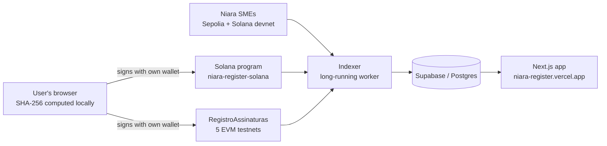

# Niara Register

**The record and trust layer of Niara: on-chain proof of existence and authorship for documents, plus a public ledger of real on-chain transactions across six networks.**

- **Live app:** [niara-register.vercel.app](https://niara-register.vercel.app)
- **Product demo (3 min):** [youtube.com/watch?v=ZNhbzGMrvZo](https://www.youtube.com/watch?v=ZNhbzGMrvZo)
- **Try it:** [niara-register.vercel.app/signatures](https://niara-register.vercel.app/signatures). Pick a network, drop a file and sign with your own wallet.

> **Status: testnet and devnet only.** Records are real transactions on public test networks. The contracts have tests but **no external audit**. A Niara Register record is a complementary piece of evidence. It does **not** replace a notary (cartório) or ICP-Brasil, and it has no automatic legal effect.

---

## What it does

Niara is a financial infrastructure that connects documents, companies, assets and markets: **Register → SMEs → Exchange → Neobank**. Register is the first layer. Every other Niara product writes its records here.

The app has three areas:

| Area | Route | What it shows |
|---|---|---|
| **Document signing** | [`/signatures`](https://niara-register.vercel.app/signatures) | The user selects a file and the browser computes its **SHA-256 hash locally**, so the file is never uploaded. The user connects a **self-custody wallet**, checks whether that hash is already on-chain, and signs a transaction that records the hash, the signer, a timestamp, and the document's name and type. Below the form is a ledger of every recorded document, from all six networks. |
| **SME Registry** | [`/sme-registry`](https://niara-register.vercel.app/sme-registry) | A mirror of the real investment transactions of [Niara SMEs](https://niara-pmes.vercel.app) (offerings created, investments, closings, share redemptions, fund releases, refunds) on **Ethereum Sepolia** and **Solana devnet**. Each entry links to its transaction on the block explorer. |
| **Global Registry** | [`/global-registry`](https://niara-register.vercel.app/global-registry) | Reserved for Niara Exchange. It is **intentionally empty** until the Exchange runs real transactions, because simulated data is never shown as real. |

There is also an `/explorer` route that reads transactions and addresses live from the official RPC. It exists for **HyperEVM Testnet**, which has no working public block explorer, and it shows the `curl` calls so anyone can repeat the query.

The site is bilingual (English by default, Portuguese available).

## Networks and contracts

The same document can be recorded and verified on six networks. The EVM contract was deployed from the same wallet at nonce 0, so it has **the same address on every EVM network**.

| Network | Contract / program | Explorer |
|---|---|---|
| **Solana devnet** | `9RPHqLouFjoUbPdcmA1GyHMeDoWvjZMuCyYFPBWLmTcR` | [Solana Explorer](https://explorer.solana.com/address/9RPHqLouFjoUbPdcmA1GyHMeDoWvjZMuCyYFPBWLmTcR?cluster=devnet) |
| Ethereum Sepolia | `0x5627857ee73f37d6da96530ed08c07339dd9d93a` | [Etherscan](https://sepolia.etherscan.io/address/0x5627857ee73f37d6da96530ed08c07339dd9d93a) |
| Base Sepolia | `0x5627857ee73f37d6da96530ed08c07339dd9d93a` | [BaseScan](https://sepolia.basescan.org/address/0x5627857ee73f37d6da96530ed08c07339dd9d93a) |
| Robinhood Chain Testnet | `0x5627857ee73f37d6da96530ed08c07339dd9d93a` | [Robinhood Explorer](https://explorer.testnet.chain.robinhood.com/address/0x5627857ee73f37d6da96530ed08c07339dd9d93a) |
| HyperEVM Testnet | `0x5627857ee73f37d6da96530ed08c07339dd9d93a` | [Niara RPC reader](https://niara-register.vercel.app/explorer/hyperevm-testnet/address/0x5627857ee73f37d6da96530ed08c07339dd9d93a) |
| Tempo Testnet | `0x5627857ee73f37d6da96530ed08c07339dd9d93a` | [Tempo Explorer](https://explore.testnet.tempo.xyz/address/0x5627857ee73f37d6da96530ed08c07339dd9d93a) |

Wallets: **Phantom or Solflare** on Solana, and **MetaMask or a compatible wallet** on the EVM networks.

The SME Registry also reads the Niara SMEs contracts: the Sepolia offering orchestrator `0xde9cc84d1300b57f640f2d1862900393b82796e5`, and the Solana devnet program `FKefGFhUmgXBM1xCtSFBWpoNnp3wuPJs6Yddpsp67J2y` ([niara-pmes-solana](https://github.com/niaragaed/niara-pmes-solana)).

**On Solana**, each record is a PDA derived from the document hash (`["assinatura", hash]`). Recording the same hash twice fails, so nobody can overwrite or back-date a document. See [niara-register-solana](https://github.com/niaragaed/niara-register-solana).

## Architecture



- **`app/`, `components/`, `lib/`**: the Next.js 16 app (React 19, Tailwind v4, TypeScript). It reads the ledger from Supabase and talks to wallets directly (ethers v6 on EVM, `@solana/web3.js` on Solana).
- **`indexer/`**: a long-running Node/TypeScript worker, hosted on Railway. It reads events from every network and writes them to Postgres. It is idempotent per `(tx_hash, log_index)` or `(network, hash)`, so it can restart without duplicating or losing rows. Each source has its own checkpoint and loop, so a slow RPC on one network never delays the others. On Solana, an event is accepted only when it was emitted inside our own program's invoke frame, so another program cannot forge a ledger entry. The indexer is a mirror, not a source of truth: the chain is the source of truth. More detail in [`indexer/README.md`](indexer/README.md).
- **`supabase/`**: the canonical schema (`schema.sql`) and numbered migrations (`migrations_002` to `migrations_010`).

## Built during the Colosseum hackathon

The site and the Sepolia indexer were started in September 2026. During the hackathon I added:

- The **Solana program** for document registration ([niara-register-solana](https://github.com/niaragaed/niara-register-solana)) and Phantom/Solflare signing and verification in the app.
- The **multichain signature ledger**: the same contract on Base Sepolia, Robinhood Chain Testnet, HyperEVM Testnet and Tempo Testnet, all indexed side by side with Sepolia and Solana.
- The **RPC-based explorer** for HyperEVM Testnet.
- The **Solana version of the Niara SMEs ledger**, indexing the [niara-pmes-solana](https://github.com/niaragaed/niara-pmes-solana) program (offering created, investment, closing, redemption, release, refund).

## v2: private records, receipts, PAdES and credentials

The signing flow (`/signatures`) now works like this, all in the browser:

1. **PAdES signature (optional), with a country selector.** The signer first picks the country / legal framework of the certificate ([`lib/pades/frameworks.ts`](lib/pades/frameworks.ts)); both write the signature as an **incremental update**, so a contract can be signed by several people in turn. The key is a certificate file (`.pfx`/`.p12`, opened only in the tab, key imported into WebCrypto as non-extractable; RSA or ECDSA P-256/P-384/P-521) or a token, smart card or installed certificate through the Lacuna Web PKI component (free on localhost; production needs a paid license in `NEXT_PUBLIC_WEBPKI_LICENSE`). Code: [`lib/pades`](lib/pades). Checked in `tests/pades.test.ts` and `tests/eu.test.ts` with OpenSSL and qpdf, and by hand with pyHanko. No timestamp; revocation is not checked by the site.
   - **Brazil — ICP-Brasil.** Policy `PA_PAdES_AD_RB_v1_3` (OID `2.16.76.1.7.1.11.1.3`, `/Filter /PBAD_PAdES`, `/SubFilter /PBAD.PAdES`, signed attributes contentType, messageDigest, signingCertificateV2, sigPolicyId). Trust: the ICP-Brasil roots in [`lib/pades/icp-roots.ts`](lib/pades/icp-roots.ts). Reference validator: [validar.iti.gov.br](https://validar.iti.gov.br).
   - **European Union — eIDAS.** PAdES baseline B-B (ETSI EN 319 142-1: `/Filter /Adobe.PPKLite`, `/SubFilter /ETSI.CAdES.detached`, signed attributes contentType, messageDigest, signingCertificateV2; no policy, no signingTime). Trust: the CAs issuing qualified certificates (service type CA/QC, status "granted") from the **EU trusted lists**, in [`public/trust/eu-trusted-cas.json`](public/trust/eu-trusted-cas.json), built by `npm run trust:eu` ([`scripts/fetch-eu-trusted-lists.mjs`](scripts/fetch-eu-trusted-lists.mjs)): it downloads the EU List of Trusted Lists, checks its XML signature against pinned LOTL signing certificates ([`scripts/eu-lotl-signers.mjs`](scripts/eu-lotl-signers.mjs)), then checks every national list's signature against the certificates the LOTL gives for that country. The browser loads the file (~1 MB gzipped) only when a signature does not chain to ICP-Brasil, and [`lib/pades/eu-trust.ts`](lib/pades/eu-trust.ts) reads the certificate's QCStatements to label it a **qualified electronic signature** (qualified certificate + key on a QSCD), an **advanced signature with a qualified certificate**, or neither. Not applied: the trusted-list status history, the per-service qualifiers, revocation and timestamps. Reference validator: the [European Commission's DSS](https://ec.europa.eu/digital-building-blocks/DSS/webapp-demo/validation). A certificate file can give at most an advanced signature with a qualified certificate: QES needs the key on a qualified device (smart card, token, eID card).
   - The on-chain record is the same for both (scheme 0, SHA-256 of the signed PDF): the framework lives in the PDF, not in the contracts.
2. **Private on-chain record.** Only the record hash, the hash scheme, a **public document type** chosen from a fixed list ([`lib/document-types.ts`](lib/document-types.ts), codes 1–11, never free text) and a salted commitment to the name/type go on-chain ([`lib/commitments.ts`](lib/commitments.ts), byte-identical to the contracts). The name is required and stays private; the public history shows the type, never the name:
   - scheme 0: SHA-256 of the signed PDF (its signature makes it unguessable);
   - scheme 1: `SHA-256("niara-record-v1" ‖ salt ‖ SHA-256(file))` for any other file.
3. **Soulbound receipt** minted to the signer in the same transaction: ERC-721 + ERC-5192 on EVM (`SignatureRegistryV2`), Bubblegum v2 cNFT in a frozen MPL-Core collection on Solana (`register_v2`; metadata served by `/api/receipts/solana/[hash]`).
4. **Proof package** (`niara-register-proof/1` JSON) with the salt, the file hash, the name/type, a **W3C VC 2.0** issued by Niara (VC-JOSE, `did:web`, key in `NIARA_VC_PRIVATE_JWK`, optional ICP-Brasil e-CNPJ chain in `NIARA_VC_X5C`) and a **presentation signed by the holder's wallet** (Ed25519 VP-JWT on Solana; EIP-712 `EthereumEip712Signature2021` on EVM — a W3C CCG draft, not a Recommendation). Niara keeps none of it.

**Wallets.** "Connect wallet" always asks which wallet to use and connects nothing before the choice: EVM wallets are discovered through EIP-6963 and Solana wallets through the Wallet Standard ([`components/v2/wallet-picker.tsx`](components/v2/wallet-picker.tsx)). Wallets on the Niara list ([`lib/wallet-catalog.ts`](lib/wallet-catalog.ts): MetaMask, Phantom, Coinbase Wallet, OKX Wallet, Rabby, Trust Wallet, Solflare, Backpack) are the only ones that can be picked; other wallets the browser announces are named as not supported; listed wallets that are missing link to their official download page. The list is enforced by the identifier each wallet announces; an extension can announce any identifier, so it curates what the site accepts but the trust boundary is still the extension the user installed. On phones and tablets (no extensions) the dialog offers to open the page inside a listed wallet's own app browser, and WalletConnect for EVM wallets on another device ([`lib/walletconnect.ts`](lib/walletconnect.ts), loaded only when picked; the connected wallet must be on the list, judged by its session metadata). Solana on mobile goes through the wallet app browsers (Phantom, Solflare). When a file is chosen it is looked up on all six networks from the browser ([`lib/multichain-lookup.ts`](lib/multichain-lookup.ts)): signed-PDF and v1 records are found by the file hash; salted records cannot be, by design. Connecting needs the document name and type first. After the transaction the receipt is already in the wallet and the proof package (with the Niara credential) is saved automatically; signing a holder presentation is optional and saves the package again.

`/verify/[network]/[hash]` reads the record straight from the chain and checks the document, the package, the credential, the presentation and the PAdES signatures in the browser. `/transferable` issues and operates **transferable records** designed to line up with MLETR (singularity, exclusive control, amendment, surrender, termination) — "aligned with MLETR", never "compliant": Brazil has not enacted it.

v2 addresses (transferable records deployed 2026-10-22; `SignatureRegistryV2` with the document type redeployed 2026-10-23, the first one is retired) live in [`lib/register-v2-evm.ts`](lib/register-v2-evm.ts) and [`indexer/config.ts`](indexer/config.ts); `NEXT_PUBLIC_V2_<NETWORK>_REGISTRY` / `_ETR` and `<PREFIX>_V2_REGISTRY` / `_ETR` / `_START_BLOCK` only override them after a redeploy. Run `supabase/migrations_011_v2.sql` and `supabase/migrations_012_v2_document_type.sql` before starting the indexer with the v2 sources.

### v3: commit-reveal and ORB attestation

`SignatureRegistryV3` deployed 2026-10-27 (ORB off: `orbAttester` = 0), from niara-contracts-Register main `67d48c0`:

| Network | Address | Block | v2 retired at (unix) |
|---|---|---|---|
| Ethereum Sepolia | `0x9fCc83555547384178Ab64a00ce579A469bd5650` | 12007158 | 1793128524 |
| Base Sepolia | `0x0d0c016E11b259050647EEa2e69A887C1128E499` | 51033363 | 1793128541 |
| Robinhood Chain Testnet | `0x0d0c016E11b259050647EEa2e69A887C1128E499` | 143759726 | 1793128552 |
| HyperEVM Testnet | `0x0d0c016E11b259050647EEa2e69A887C1128E499` | 68047077 | 1793129011 |
| Tempo Testnet | `0x0d0c016E11b259050647EEa2e69A887C1128E499` | 41444021 | 1793129021 |

Solana: `register_v3` goes live with the program upgrade; the site switches with
`NEXT_PUBLIC_SOLANA_REGISTER_V3=1` in the same release.

v2's single `register` call could be front-run: anyone watching the mempool could copy it and land
first. v3 (`SignatureRegistryV3` on EVM, `commit` + `register_v3` on Solana) registers in two
wallet confirmations: a commitment that reveals nothing (`lib/commit-reveal.ts`), then the
registration in a later block with the nonce. The site switches per network when a v3 address
exists in `lib/register-v2-evm.ts` (`NEXT_PUBLIC_V3_<NETWORK>_REGISTRY` for local tests) and, on
Solana, when `NEXT_PUBLIC_SOLANA_REGISTER_V3=1` (set it in the deploy that follows the program
upgrade, because the upgrade removes `register_v2`). Until then v2 keeps working, front-running
included.

v3 records can carry the hash of an **ORB analysis report**, accepted on-chain only with a signature
from the ORB attester key (EIP-712 on EVM, Ed25519 on Solana), so "ORB analysis: yes" on the
receipt and on `/verify` is not something the user can set alone. The site sends no ORB attestation
yet: that waits for the ORB service and its key (AWS KMS before mainnet).

**One record per (document, signer).** In v2 the first wallet to register a hash owned it, so whoever
held the hash first (the other party of a contract, say) could lock the real signer out. In v3 every
wallet that registers a hash gets its own record and receipt; only the same wallet registering the
same hash twice is refused. `readRecords` returns all records of a hash (oldest first), `/verify`
lists them (`?signer=` picks the one the proof check uses) and credentials name the signer.

**Retired v2.** v2 is ownerless and cannot be paused, so after the switch anyone could still write a
copy of a v3 registration there. `V2_RETIRED_AT` in `lib/register-v2-evm.ts` (unix time of the v3
deploy block, per network; the indexer's `<PREFIX>_V2_RETIRED_AT`) marks the moment v2 stopped being
Niara's registry: v2 records made after it are shown as "not counted" and never used (credentials,
proof checks, the "already registered" check). Set it in the same release that sets the v3 address.
On Solana the upgrade removes `register_v2`, so no such records can exist there.

The indexer scans v3 with the same loops (`<PREFIX>_V3_REGISTRY`; Solana events from the same
program) after `supabase/migrations_014_v3_commit_reveal_orb.sql` and
`supabase/migrations_015_v3_one_record_per_signer.sql`.

## Running locally

Web app: create `.env.local` with `NEXT_PUBLIC_SUPABASE_URL`, `NEXT_PUBLIC_SUPABASE_ANON_KEY` and, optionally, `NEXT_PUBLIC_SOLANA_RPC_URL`, `NIARA_VC_PRIVATE_JWK` (from `node scripts/generate-vc-key.mjs`; keep it in the host's secret store), `NIARA_DID_DOMAIN`, `NIARA_VC_X5C`, `NEXT_PUBLIC_WEBPKI_LICENSE` and `NEXT_PUBLIC_WALLETCONNECT_PROJECT_ID` (free, from dashboard.reown.com, with the site's domains in the project's allowlist; without it the WalletConnect option is hidden). Then:

```bash
npm install
npm run dev                        # http://localhost:3000
npm test                           # hash recipes, PAdES ICP-Brasil and EU (OpenSSL/qpdf if installed), credentials
npm run trust:eu                   # refresh public/trust/eu-trusted-cas.json from the EU trusted lists
```

Indexer: create `indexer/.env` with `ALCHEMY_API_KEY`, `SUPABASE_URL` and `SUPABASE_SERVICE_ROLE_KEY`. Every RPC URL and network setting has a default (see [`indexer/config.ts`](indexer/config.ts)). Then:

```bash
cd indexer
npm install
npm start                          # or: npx tsx index.ts --dry-run (reads everything, writes nothing)
npm test                           # offline tests + one cycle against Solana devnet
```

Apply `supabase/schema.sql` and every `supabase/migrations_0*.sql` file, in order, before starting the indexer.

## Naming

Code, comments, docs and logs are in English. A few names stay in Portuguese because they are external interfaces: on-chain contract, event and field names (`RegistroAssinaturas`, `DocumentoRegistrado`, `OfertaCaptacao`, `Aporte`...), Supabase table and column names (`registro_transacoes`, `tipo_evento`, `ocorrido_em`...), the keys of the stored `dados` JSON, values already stored in the database (`tipo_evento`, `descricao`, `fonte`, `status`), and the indexer's environment variables. The Portuguese UI copy in `lib/i18n/dictionaries.ts` is the Brazilian version of the site.

## The Niara ecosystem

Niara has 8 repositories at [github.com/niaragaed](https://github.com/niaragaed):

| Repository | Role |
|---|---|
| **Niara-Register** (this repo) | Web app and indexer for the record and trust layer |
| [niara-register-solana](https://github.com/niaragaed/niara-register-solana) | Anchor program for Register on Solana devnet |
| [niara-contracts-Register](https://github.com/niaragaed/niara-contracts-Register) | Solidity document-registration contract, deployed on 5 EVM testnets |
| [niara-PMEs](https://github.com/niaragaed/niara-PMEs) | Niara SMEs web app: companies create offerings, investors invest with self-custody wallets |
| [niara-contracts-PMEs](https://github.com/niaragaed/niara-contracts-PMEs) | Solidity contracts for SME fundraising under Brazil's CVM Resolution 88, on Sepolia (315 tests) |
| [niara-pmes-solana](https://github.com/niaragaed/niara-pmes-solana) | Solana port of the SME fundraising flow, with an on-chain escrow, on devnet |
| [niara-contracts](https://github.com/niaragaed/niara-contracts) | Base contracts for Niara Exchange: asset tokens backed by attested custody, atomic settlement, issuer cashback (tested locally, not deployed) |
| [niara-site](https://github.com/niaragaed/niara-site) | Niara Exchange front-end prototype: trading terminal, order book, portfolio (simulated data) |

---

*Your assets. Truly yours.*
